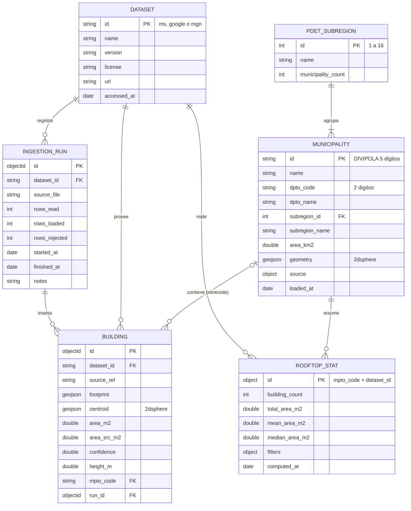

# Diagrama E-R (fuente editable)

Versión Mermaid de `diagrama_er.png`. GitHub la dibuja automáticamente.
En MongoDB, `id` corresponde al campo `_id` de cada colección.

6 entidades y 7 relaciones uno a muchos. La relación MUNICIPALITY-BUILDING es
espacial: `mpio_code` se llena con `$geoWithin` sobre el centroide en la fase 3,
no durante la carga. Si el centroide no cae en ningún municipio PDET, `mpio_code`
queda en `null`.

