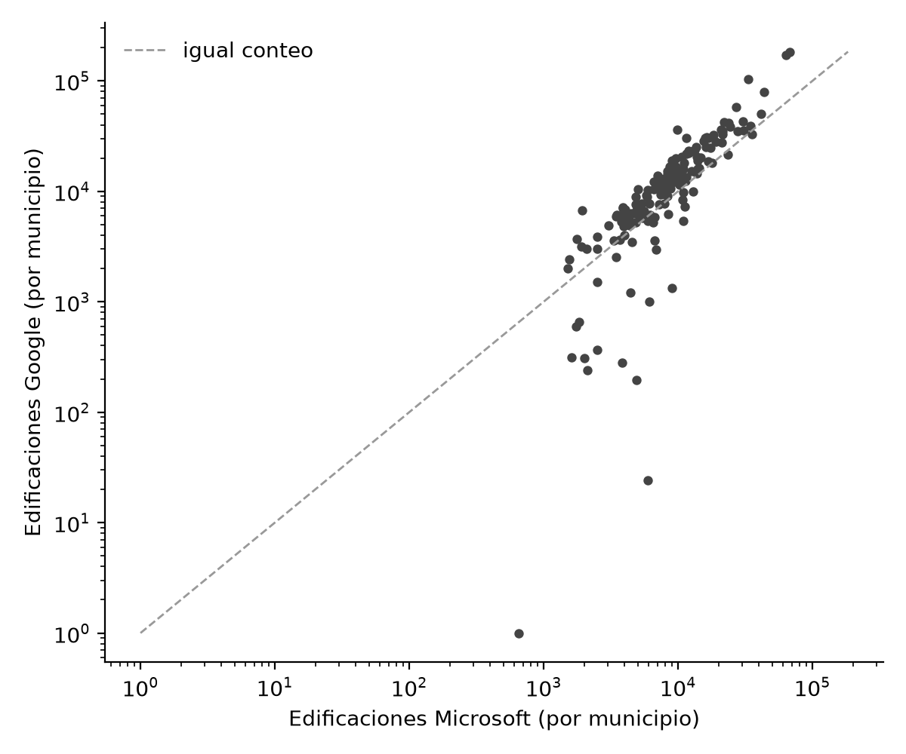
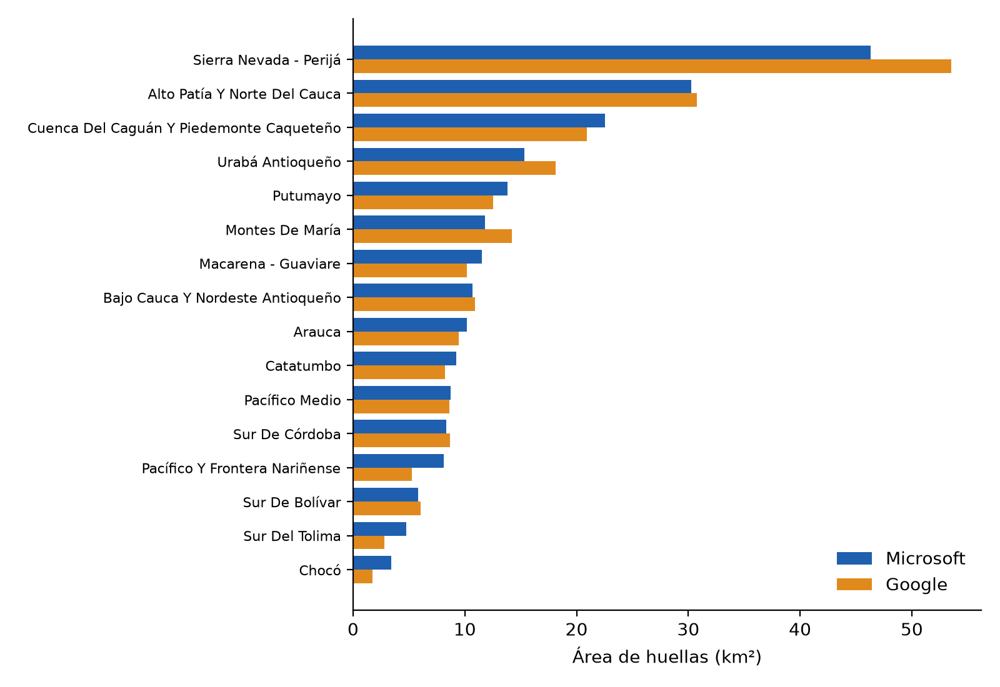

# Entrega 3: análisis exploratorio de las huellas cargadas (EDA)

Script: [`scripts/05_eda_buildings.py`](../../scripts/05_eda_buildings.py).
Resumen completo: [`outputs/eda/eda_buildings_summary.json`](../../outputs/eda/eda_buildings_summary.json).

## Entradas y por qué alcanzan

El EDA lee las salidas medidas de la preparación: el conteo y el área por
municipio (`outputs/buildings_<fuente>_prepared_by_municipality.csv`), los
totales y percentiles de área (`outputs/buildings_<fuente>_prepare_report.json`)
y la subregión PDET de cada municipio (`outputs/pdet_mgn_crosswalk.csv`). La
carga comprobó que la base tiene exactamente esos documentos y esos municipios
(`count_matches_prepared` y `municipalities_match_preparation` en
`outputs/buildings_<fuente>_load_report.json`). Por eso el EDA no necesita
MongoDB ni los archivos crudos, y cualquier integrante lo puede repetir.

El script falla si un CSV no tiene los 170 municipios PDET o si su suma no
coincide con el total del reporte. Para revisar la base cargada se usa
`python scripts/04_load_buildings.py --source <fuente> --verify-only`, que
repite las verificaciones de conteo, duplicados, índice `centroid_2dsphere` y
consulta `$geoWithin` sin insertar nada.

```bash
python scripts/05_eda_buildings.py
python -m unittest discover -s tests -p "test_eda_buildings.py" -v
```

## Hallazgos principales

| Indicador | Microsoft | Google |
| --- | ---: | ---: |
| Edificaciones en municipios PDET | 1.761.030 | 2.694.775 |
| Municipios PDET con edificaciones | 170 de 170 | 165 de 170 |
| Área total de huellas | 221,0 km² | 222,1 km² |
| Mediana del área de huella | 76,9 m² | 57,8 m² |
| Edificaciones por municipio (mediana) | 8.161 | 11.018 |

1. **Google detecta 53 % más edificaciones, pero el área total es casi igual**
   (razón de área 1,005). Las huellas de Google son más pequeñas en toda la
   distribución, no solo en la mediana (tabla de distribución del área).
2. **Las dos fuentes ordenan los municipios casi igual.** La correlación de
   Spearman entre fuentes es 0,904 para el conteo por municipio y 0,938 para
   el área. Google tiene más edificaciones en 133 de los 165 municipios comunes.
3. **Google casi no tiene huellas en el Pacífico.** En 15 municipios Google
   tiene menos del 20 % de las edificaciones de Microsoft, y en 5 no tiene
   ninguna (tabla de baja cobertura de Google). Casi todos están en Chocó y en la costa Pacífica. La
   causa no está verificada: puede ser la cobertura de detección de Google en
   esa zona. Sebastián ya advirtió que la cobertura de las particiones S2 no
   garantiza detecciones en cada municipio.
4. **El 1 % superior de huellas pesa mucho en el área total.** En Microsoft el
   percentil 99 es 912 m² y el máximo 44.720 m²: son bodegas e instalaciones
   grandes. La Entrega 4 debe decidir si esas huellas cuentan como techos
   aprovechables.



**Distribución del área de huella (m²)**

| Fuente | p01 | p10 | p50 | p90 | p99 | máx. |
| --- | ---: | ---: | ---: | ---: | ---: | ---: |
| Microsoft | 17,6 | 28,8 | 76,9 | 229,5 | 912,0 | 44720,4 |
| Google | 7,4 | 16,7 | 57,8 | 159,9 | 444,9 | 20829,7 |

## Por subregión PDET

Sierra Nevada - Perijá concentra la mayor área de huellas en las dos fuentes.
Chocó, Sur del Tolima y Pacífico y Frontera Nariñense son las únicas
subregiones donde Google suma bastante menos área que Microsoft.



**Edificaciones y área por subregión PDET (orden por área de Microsoft)**

| Subregión PDET | Municipios | Edif. Microsoft | Área MS (km²) | Edif. Google | Área Google (km²) |
| --- | ---: | ---: | ---: | ---: | ---: |
| Sierra Nevada - Perijá | 15 | 295.380 | 46,3 | 645.006 | 53,5 |
| Alto Patía Y Norte Del Cauca | 24 | 271.665 | 30,3 | 388.376 | 30,8 |
| Cuenca Del Caguán Y Piedemonte Caqueteño | 17 | 133.939 | 22,6 | 182.694 | 20,9 |
| Urabá Antioqueño | 8 | 113.400 | 15,3 | 218.241 | 18,2 |
| Putumayo | 9 | 108.450 | 13,8 | 136.711 | 12,6 |
| Montes De María | 15 | 129.387 | 11,8 | 215.874 | 14,2 |
| Macarena - Guaviare | 12 | 94.110 | 11,5 | 113.455 | 10,2 |
| Bajo Cauca Y Nordeste Antioqueño | 13 | 102.403 | 10,7 | 142.780 | 10,9 |
| Arauca | 4 | 74.674 | 10,2 | 111.739 | 9,4 |
| Catatumbo | 8 | 89.632 | 9,2 | 104.279 | 8,2 |
| Pacífico Medio | 4 | 49.595 | 8,8 | 116.254 | 8,6 |
| Sur De Córdoba | 5 | 80.633 | 8,3 | 114.887 | 8,7 |
| Pacífico Y Frontera Nariñense | 11 | 79.142 | 8,1 | 71.020 | 5,3 |
| Sur De Bolívar | 7 | 52.856 | 5,8 | 80.075 | 6,0 |
| Sur Del Tolima | 4 | 48.072 | 4,8 | 32.662 | 2,8 |
| Chocó | 14 | 37.692 | 3,4 | 20.722 | 1,7 |

## Municipios con baja cobertura de Google

**Municipios donde Google tiene menos del 20 % de las edificaciones de Microsoft**

| Código | Municipio | Subregión | Edif. Microsoft | Edif. Google |
| --- | --- | --- | ---: | ---: |
| 05475 | Murindó | Chocó | 1.331 | 0 |
| 05873 | Vigía Del Fuerte | Chocó | 1.714 | 0 |
| 27099 | Bojayá | Chocó | 2.004 | 0 |
| 27450 | Medio San Juan | Chocó | 1.627 | 0 |
| 27491 | Nóvita | Chocó | 1.403 | 0 |
| 27745 | Sipí | Chocó | 653 | 1 |
| 19418 | López De Micay | Pacífico Medio | 5.968 | 24 |
| 52612 | Ricaurte | Pacífico Y Frontera Nariñense | 4.878 | 196 |
| 27150 | Carmen Del Darién | Chocó | 3.832 | 281 |
| 27205 | Condoto | Chocó | 2.110 | 239 |
| 52621 | Roberto Payán | Pacífico Y Frontera Nariñense | 2.501 | 364 |
| 73616 | Rioblanco | Sur Del Tolima | 9.018 | 1.329 |
| 27250 | El Litoral Del San Juan | Chocó | 2.010 | 309 |
| 27615 | Riosucio | Chocó | 6.107 | 1.000 |
| 27425 | Medio Atrato | Chocó | 1.615 | 313 |


## Consecuencias para la Entrega 4

- Microsoft es la fuente base del conteo y del área, porque cubre los 170
  municipios. Google se reporta aparte como contraste.
- En los municipios con baja cobertura de Google, el resultado de Google no es comparable y se
  marca como cobertura insuficiente.
- No se suman las dos fuentes: detectan las mismas edificaciones con formas y
  tamaños distintos.
